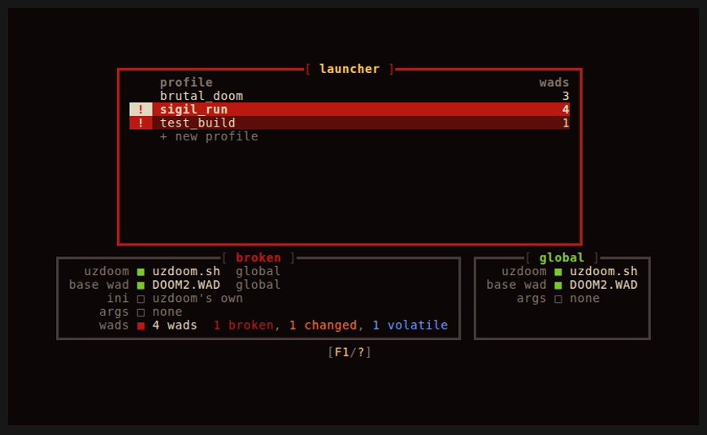
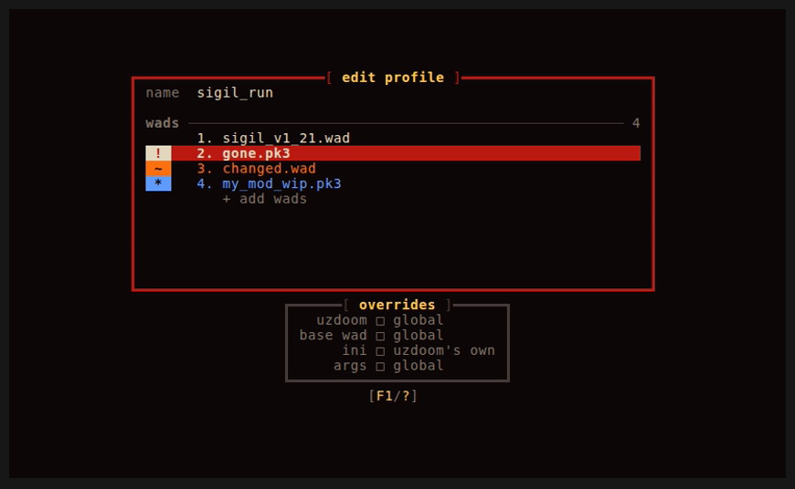
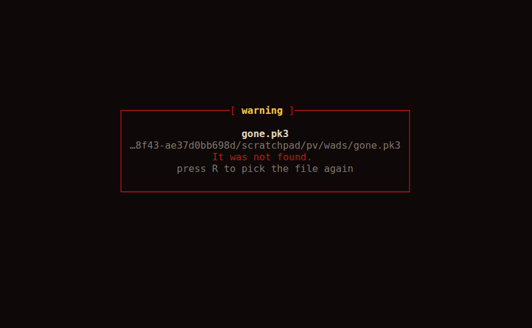
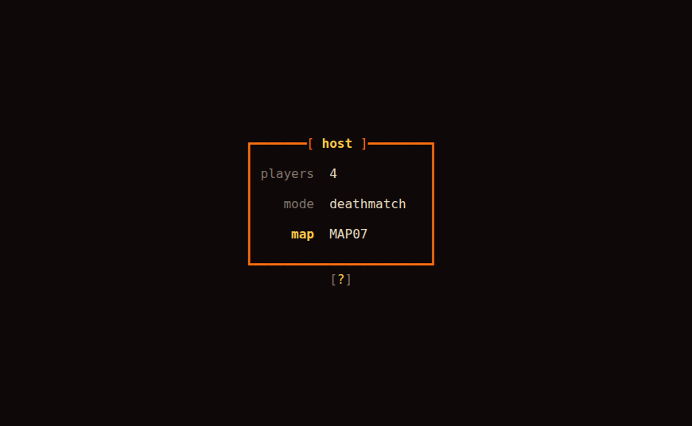
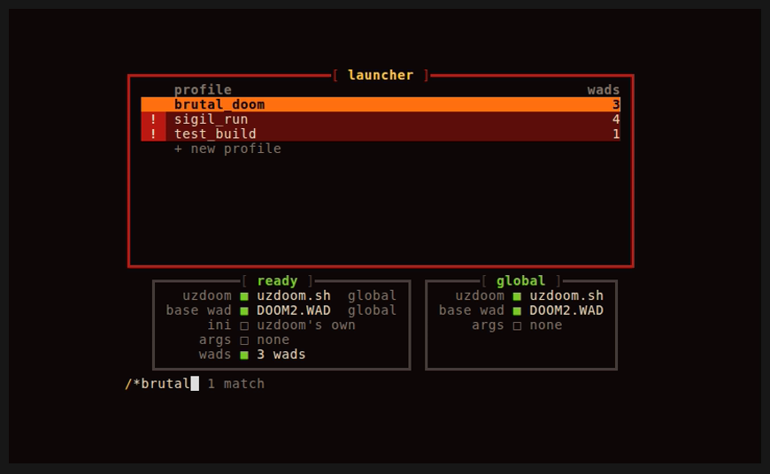
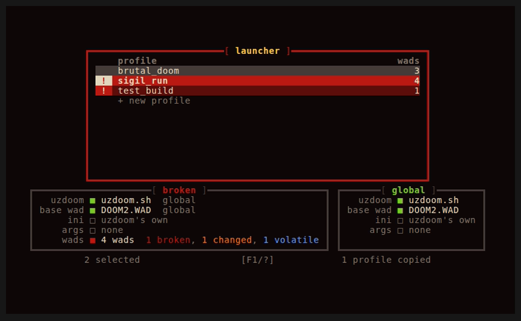
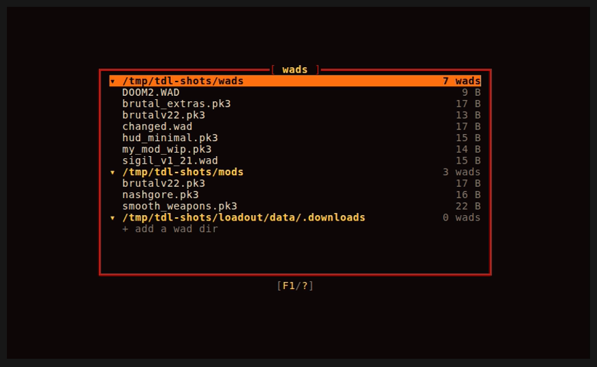
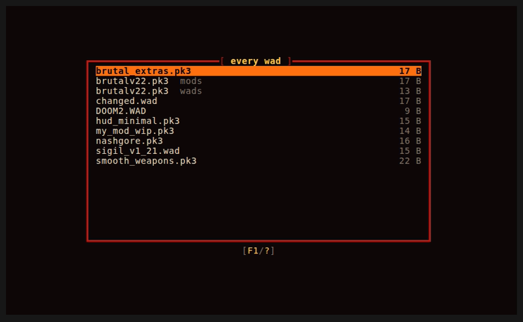
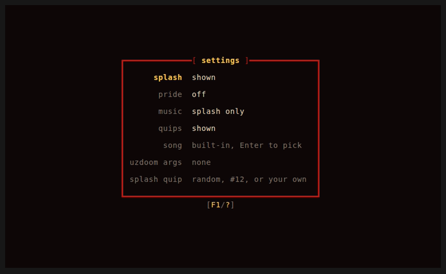

# tdl

> **AI notice:** this project is developed with the help of AI. Much of the code and documentation was written with [Claude](https://claude.ai) (Anthropic), working under my direction and review. Commits that Claude helped write carry a `Co-Authored-By: Claude` trailer, so you can see which ones in the history.

A terminal launcher for [UZDoom](https://github.com/UZDoom/UZDoom). Group your wads into named profiles, launch them in one keypress, and host or join multiplayer games, with missing wads downloaded automatically from the host.

## Consideration
**WARNING:** this project holds a secret evil ritual. It reveals unsafe and spooky, unstable, cursed, and useless verses that can only be read at night. It allows the user to speak with the dead and heed their omens, but beware, for the ghosts has escaped their sealing circle!

But seriously, why would anyone want to use a partially vibe-coded app like this? Well, it didn't start out like that. At the beginning, I was writing this almost completely by hand, with AI helping to provide documentation and examples for dependencies, along with the occasional ask for suggested names or tradeoffs for decisions. I began this project with an idea, for a better launcher, one that I could use to play wads with my good friends simply, even ones that I might be developing. As you might guess, the terminal intrigues me, and it's just simpler to develop for. Its mysterious and minimal, yet powerful nature is exactly the thing I wanted to embody within tdl. It may not be so minimalistic anymore with all the features and the bloated size of the binaries, but it can be used as minimally as possible. The thing I prioritized was the fun of it all. I want myself, my friends, and any other users to enjoy using this and get Dooming! 

I think one of the problems people have with AI use in a project is the fear that it wont't be maintained properly or become abandoned. I remember hearing a metaphor about programming: writing code is like gardening. You always have to tend to it, because it's never finished. You're always pulling weeds and squashing bugs, and as you accumulate more crops, the weeds and bugs multiply. Now add super-powered, loyal, yet ultimately untrustworthy helpers into the mix and you'll get a recipe for uncertainty. Those helpers allow almost anyone to garden and let professional gardeners cultivate and transform their oases like never before. However, with it hides the possibility of even more devious cruft and infestations, especially for groundskeepers that tend to neglect or maintain unkempt wildernesses, festered by overriliance on their familiars. There are more plots being created than ever before by our AI frienemies and people in general need to be wary.

I want to be a good maintainer and don't want rampant AI to fester this project. Having a comprehensive yet understandable source code and program is the ultimate goal here and I will continue that goal for the foreseeable future. 

In most bug-ridden of days, in most unstable of nightly,\
No error shall escape my sight.\
Let those who worship slops' might,\
Beware the code -- a programmer's rite!


## Features

- **Profiles**: an ordered list of wads with an optional per-profile UZDoom binary, base wad and `.ini`
- **One-key launch**: pick a profile and press `Enter`
- **Host**: choose player count, deathmatch or co-op, a starting map, the port and a join code
- **Join**: enter the host's IP and join code; tdl picks a compatible profile, or offers to download the wads and create one
- **Import** a whole dir of wads into a profile, or make a profile that **watches a dir** and takes in whatever wads you put there
- **Search** with `/`: profiles by name (or by their wads with `*`), and wads by file name in the editor
- **Copy, cut and paste** profiles and wads, one or many at a time, with `Shift+V`/`M` to select, `Y`, `X` and `P`
- **Wads screen** (`L`): every wad in every wad dir and the downloads, by dir or all in one list, to copy or move between dirs or paste into a profile
- **Per-profile saves** and a `session.log` of UZDoom's output
- **Status at a glance**: a panel under the launcher shows what the selected profile would run with (UZDoom, base wad, ini, wads) and whether anything is broken, with the global settings (UZDoom, base wad, ini, UZDoom arguments) beside it
- **Themes**: every color, border and glyph comes from a `theme.toml` you can change, or the built-in hellfire one, and the splash screen dresses up in its own `splash.toml` (logo, words, and a fire that can cycle through any colors) and `pride.toml` (pride flags, one picked at random each time)
- **Placeholders, not surprises**: a wad that moved is shown in the editor with what's wrong, and only that profile is held back from launching
- **Fits any terminal** from 40×20 up: every window is sized from what it holds, and long lists scroll

## Screenshots

The profiles here are examples made for the screenshots.

| | |
| --- | --- |
|  |  |
| **Launcher.** Every profile on screen gets a badge: `!` broken, `~` changed, `*` volatile. The panel underneath shows what the selected one would launch with, and the one beside it the global settings it falls back on. | **Editor.** The same badges for each wad, drawn on top so the cursor never hides them, and under it what the profile overrides. |
|  |  |
| **Inspecting a wad.** `Space` on a marked wad says what's wrong and how to fix it. | **Hosting.** Player count, mode, map, port and join code; an empty map lets UZDoom pick. |
|  |  |
| **Searching.** `/` and a name; a `*` in front looks in the wads instead. Nothing moves until `Enter`. | **Selecting and copying.** `Shift+V` and `M` pick rows; the row under the panel says what is selected and what is copied. |
|  |  |
| **Wads screen.** `L`: every wad dir and the downloads, each with every wad in it, to copy or move between dirs or paste into a profile. | **Every wad.** `Tab` on the wads screen: one list by name, where wads with the same name are told apart by their dirs. |
|  | |
| **Settings.** `O` in the launcher: the splash and the pride splash, the music, quips and song, the theme, the splash's look and the pride flags, the ini, the UZDoom arguments and the splash quip, the same in every loadout. | |

## Requirements

- Rust **1.99.1** or later, stable or nightly (on nightly, `--features spooky` turns on the unstable features the code was written for; the build is the same either way)
- [UZDoom](https://github.com/UZDoom/UZDoom) installed
- A Doom base wad (e.g. `DOOM2.WAD`, or the free [Freedoom](https://freedoom.github.io/))
- Python 3.8 or later, only to [upgrade the files of a tdl before 1.0.0](#upgrading-from-before-100) and to [host a mod folder](#mod-folders)

## Install

```sh
git clone https://codeberg.org/Error-ErrorFruitUser/tdl.git
cd tdl
cargo build --release                              # stable
cargo +nightly build --release --features spooky  # or nightly, with its unstable features
./target/release/tdl
```

## Usage

On first run, press `U` to select your UZDoom executable and `W` to select a base wad, then `A` to create a profile.

### Command line

```sh
tdl [--session] [<dir> | --loadout <dir> | --keep-loadout <dir> | --forget-loadout | --keep-forget-loadout] [--wads <dir>... | --keep-wads <dir>... | --keep-loadout-wads <dir>... | --forget-wads | --keep-forget-wads] [--uzdoom <file> | --keep-uzdoom <file>] [--base-wad <file> | --keep-base-wad <file>] [--ini <file> | --keep-ini <file>] [--theme <file> | --keep-theme <file>] [--splash <file> | --keep-splash <file>] [--unseal <scroll> | --unseal-delete <scroll> | --unseal-delete-force <scroll>] [--no-splash] [--splash-quip <quip> | --no-quips] [[--music <song>] [--keep-music] | --no-music] [--with-pride]
tdl launch|host|join ...                  # see Commands below
tdl --seal <scroll> [--with-settings]
tdl --list-quips
```

`tdl --help` (or `tdl host --help`, and so on) lists everything, and `tdl --version` says which tdl it is. A mistyped option is answered with the closest real one.

#### Keeping what you pass

What you give tdl on the command line (a loadout, wad dirs, a UZDoom, a base wad, an ini, a theme, a splash) is used for the run, and then tdl asks whether to keep it. Each of those flags comes three ways:

- the plain flag (`--uzdoom <file>`) uses it and **asks** whether to keep it;
- with `--session` anywhere on the command line, every plain flag is **just for this run**: nothing is asked, and nothing is kept. Forgetting is just for the run too;
- its `--keep-` flag (`--keep-uzdoom <file>`) uses it and **keeps it without asking**, even with `--session`, so `tdl --session --keep-theme blue.toml --uzdoom ./uzdoom-dev` keeps the theme but tries the UZDoom build only once.

With `--headless` and `--seal` there are no windows to ask in, so the plain flags are just for the run, and only the `--keep-` flags keep anything.

- `--loadout <dir>` keeps everything in `<dir>/config` and `<dir>/data` instead of the standard dirs, and asks whether to open that loadout every time tdl starts. `tdl <dir>` on its own is the same. `--keep-loadout <dir>` opens it every time without asking.
- `--forget-loadout` opens the standard loadout, and asks whether to stop opening the one remembered from `--loadout`. `--keep-forget-loadout` stops opening it without asking; with `--session`, `--forget-loadout` opens the standard loadout just for this run.
- `--wads <dir>` (as many times as you like) says where your wads are: file pickers open there instead of the current directory, and joining looks there for wads you already have. tdl asks whether to keep the dirs for this **[S]ession** only, **[G]lobal**ly for every loadout, or for this **[L]oadout**. Kept dirs are used whenever tdl starts without `--wads`: the loadout's own first, then the global ones. `--keep-wads <dir>` keeps them for every loadout without asking, and `--keep-loadout-wads <dir>` for this loadout.
- `--forget-wads` looks for wads only in the downloads this run, and asks whether to forget the wad dirs kept **[G]lobal**ly, for this **[L]oadout**, or **[B]oth**. `--keep-forget-wads` forgets them all without asking.
- `--uzdoom <file>`, `--base-wad <file>` and `--ini <file>` play with that UZDoom, base wad or UZDoom ini for the run, over every profile's own and the global one (the launcher's panels mark them **session**), for trying another UZDoom build, IWAD or config quickly. tdl then asks whether to keep each as the global one, used by every profile without its own. `--keep-uzdoom`, `--keep-base-wad` and `--keep-ini` keep it without asking. A file that isn't there stops tdl before it starts.
- `--theme <file>` wears the theme in that `theme.toml` (see [THEME.md](THEME.md)), from the first window on, or the one of that name (`--theme voidless`: your own `voidless_theme.toml` in the config dir, or one that comes with tdl: `hellfire`, the built-in one; `voidless`, violet and teal over near black; and `monokai`, `gruvbox`, `noctis`, `dracula`, `nord`, `catppuccin`, `tokyo-night`, `solarized`, `rose-pine`, `everforest`), and asks whether to keep wearing it; `--keep-theme <file>` keeps it without asking. A theme tdl can't wear stops it before it starts, and says what is wrong with it.
- `--splash <file>` plays the splash screen in the look of that `splash.toml` (see [SPLASH.md](SPLASH.md)), or of the one of that name (`--splash voidless`: a white fire with violet and teal embers), even if the **splash** setting skips it (`--no-splash` still wins), and asks whether to keep it; `--keep-splash <file>` keeps it without asking. One tdl can't wear stops it before it starts, and says what is wrong with it.
- `--unseal <scroll>` imports a shared `.scroll` as soon as tdl starts, just like `I` in the launcher, looking for its wads in the wad dirs: `tdl --unseal shared.scroll --wads ~/wads`.
- `--unseal-delete <scroll>` unseals a scroll in place of the loadout's profiles: every profile is deleted first, with its saved games and logs, and the scroll's go in. The downloaded wads stay, so nothing has to be downloaded again, and so do your global settings. It asks first; `--unseal-delete-force <scroll>` doesn't. Restoring a backup made with `--seal` is `tdl --unseal-delete-force backup.scroll`.
- `--splash-quip <quip>` shows your own quip under the splash logo instead of a random one, just for this run: `tdl --splash-quip "Rip and tear, bestie!"`. Every `#<number>` in it is replaced by that built-in quip, counting from 1 (`tdl --list-quips` prints them all with their numbers): `#12` is quip 12 alone, and `#12, hun!` is quip 12 with `, hun!` right after it, no space added. Write `##` for a plain `#` in front of digits. It plays the splash even if the **splash** setting is off, and can't go with `--no-splash`. The progress windows keep their usual quips. `--no-quips` leaves the quips out of every window for this run, the same as the **quips** setting.
- `--music <song>` plays your own song (wav, mp3, flac or ogg) instead of "Inevitable Doom". It is checked before tdl starts, so a file it can't play is reported right away. `--keep-music` keeps the music going in the launcher after the splash, as the **music** setting does. To use your song every time, pick it in the **song** setting. `--no-music` plays no music at all for this run, not even on the splash, and can't go with the other two.
- `--seal <scroll>` seals every profile in the loadout into a new `.scroll`, with no windows, and closes: `tdl --seal backup.scroll`. It never writes over a file that is already there. `--with-settings` seals your global settings in too (never your song); whoever unseals it gets them in place of their own.
- `--with-pride` plays the pride splash for the run (the **pride** setting plays it every time): a fire that burns through every color of the rainbow, under the logo in the stripes of a pride flag, built in the trans flag's: blue, pink, white, pink, blue. Put more flags in with the **pride flags** setting (the rainbow flag and many others are ready to switch on) and each splash picks one at random; see [SPLASH.md](SPLASH.md). Without it the logo cools a step a row, from white-hot flame at the top to blood at the bottom.

#### Commands

`launch`, `host` and `join` do one thing straight away, without the launcher, and tdl closes when they are done (the game ends, or something stops it). tdl's own options can go before or after the command, and each command's own flags go after it (`tdl host brutal_doom --coop`). `Ctrl+C` stops the game (and the wad server, when hosting) and closes tdl with exit code 130, as an interrupted program does.

```sh
tdl launch brutal_doom                                # play a profile
tdl host brutal_doom --players 4 --coop --map MAP07  # the host form, filled in from these
tdl join 10.0.0.2 --code abc234 --port 9000           # the join form, filled in from these
```

- `host` opens the host form for the profile, filled in from its saved host defaults and changed by `--players` (2–8), `--coop` or `--deathmatch`, `--map`, `--port`, `--code`, and `--share-ini` or `--no-share-ini` (whether joiners can play with your ini, see Multiplayer); `Enter` starts the game.
- `join` opens the join form, filled in with the IP, `--code` and `--port` (8080 if not given), then finds or downloads a profile. With `--always-download` the wads you don't have are downloaded without asking first, with `--host-ini` you play with the host's ini, if it shares it, and with `--host-ini-with-keys` its key bindings too (see Multiplayer).
- `--headless`, with `launch`, `host` or `join`, shows no forms and no windows at all: just plain lines in the terminal, so `join` needs `--code`. Joining still asks `[Y/N]` before downloading wads that aren't installed (no answer, or no terminal to ask on, is no), unless `--always-download` is given, and asks `[r/n/S]` about a wad of yours that isn't the host's version (see Multiplayer; no answer is skip, and `--always-download` replaces it without asking); a profile made for it is named after the host (`joined_10_0_0_2`). Anything that stops the game ends tdl with an error code, and `Ctrl+C` stops a game or a download cleanly, leaving any finished downloads for next time.

| Key | Action |
| --- | --- |
| `Enter` | Launch the selected profile (on `+`, create a profile) |
| `H` | Host a game |
| `N` | Join a game |
| `J`/`K`, `↓`/`↑` | Move the cursor |
| `/` | Search profiles by name, or by their wads' file names with `*` in front (`*brutal`). Nothing moves while you type; `Enter` goes to the best match and `Esc` cancels |
| `;` / `,` | Go to the next / previous match of the last search, best first |
| `}` / `{` | Move the profile down / up |
| `Shift+V` | Start selecting a range of profiles (`J`/`K` stretch it), or stop |
| `M` | Mark or unmark the profile, to select profiles that aren't next to each other |
| `Y` / `Shift+Y` | Copy the selected profiles (or the one under the cursor) / every profile |
| `X` | Cut the selected profiles (or the one under the cursor): nothing moves until `P` pastes them, which moves them in front of the cursor, saves and all |
| `P` | Paste: copied profiles go in front of the cursor, and copied wads go at the end of the profile (asks first) or, on `+`, start a new profile |
| `A` | Add a profile |
| `F` | Add a profile that watches a dir (see below) |
| `E` | Edit a profile |
| `D` | Delete a profile |
| `S` | Seal the profile (or the selected ones, or the whole loadout) into a `.scroll` to share |
| `I` | Import a `.scroll`, adding its profiles |
| `U` | Select the UZDoom executable |
| `W` | Select the base wad |
| `L` | The wads screen: every wad dir and its wads (see below) |
| `O` | Settings: the splash screen and its look, pride, the music, the song, the quips, the theme, the ini, and extra UZDoom arguments |
| `Esc` | Save and quit |
| `F1` / `?` | Show the keys for the current screen (`F1` works everywhere, even where `?` is typed as text) |

Inside the profile editor, `Enter` saves and leaves; `Esc` leaves too, but if the profile changed it first asks whether to **[S]ave**, **[D]iscard**, or go **[B]ack**. Saving under a name another profile has asks whether to replace that profile (deleting it and its saves; an edited profile keeps its place and its own saves), or go back to the editor. `Tab` switches between the name and the wad list, where `A` adds a wad, `Shift+A` a [mod folder](#mod-folders), `F` imports a dir, `D` removes one, `}`/`{` reorder, `U`/`W`/`I` set the profile's own UZDoom, base wad and ini (for the ini, **Global** is the one from the settings, or UZDoom's usual one), and `G` its own UZDoom arguments (used instead of the global ones from the settings; left empty, the global ones count). `/` searches the wads by file name (never by dir) and `;`/`,` step through the matches. `Shift+V` and `M` select wads, `Y` copies the selected ones (or the one under the cursor), `Shift+Y` copies every wad, `X` cuts (copies, then takes them out), and `P` pastes in front of the cursor; copied profiles paste as all their wads. `N` renames a wad's file (see [the wads screen](#the-wads-screen)), `L` opens the wads screen, and `T` makes the profile watch a dir, or stop watching one.

### Profiles that watch a dir

`F` in the launcher picks a dir and makes a profile named after it, with every wad in it (at any depth). From then on the profile keeps up with the dir by itself: whenever tdl starts, before the profile is launched or hosted, and when it is opened in the editor, wads put in the dir are added at the end (in path order) and wads whose files have left it are taken out. The panel under the launcher shows the dir it watches. Otherwise it is a profile like any other: wads can be reordered, and wads from anywhere else added. A wad from the dir taken out by hand stays out until it is put back. `T` in the editor gives any profile a dir to watch, or stops watching one (its wads stay). A watched dir that isn't there, like an unplugged drive, changes nothing, and a sealed scroll holds the profile's wads as they are, as an ordinary profile.

### Volatile wads

A wad you are still working on changes all the time, so the hash and size tdl stored for it go stale. `V` on it in the editor's wad list marks it **volatile** (and `V` again unmarks it). It gets a cyan `*`, and so does its profile in the launcher. A volatile wad is still a wad like any other, with a few differences:

- It is never marked `~` for changing size; only a missing or unreadable file counts as broken.
- `R` picks its file again without asking about a different hash, and it stays volatile.
- When you host, it is hashed again right before the wad list is served, so joiners get the version that is on your disk now, not the one you added.
- Copies, pasted profiles and sealed scrolls keep it volatile.

When you join, a volatile wad stands in for the host's wad of the same file name, whatever its contents, so a profile that only differs from the host's in volatile wads still counts as matching. tdl hashes each of those wads again first, since the stored hash is often only out of date. If the file turns out to be the host's version after all, the new hash is just saved. If it really differs, the host's version is downloaded and put in its place **without asking**: your old file is kept beside it as `<file>.bak` (writing over any older `.bak`), and every profile using it is updated with the new hash and stays volatile. The same goes for any file with the name of one of the host's wads that a profile of yours has as volatile, even when no profile matches. If the download fails, tdl says so and asks whether to join anyway with your own versions. Headless joins do all the same, saying each wad they replace, and join with your own versions if a download fails.

That keeps everyone in step with a mod that is still in progress: whoever hosts serves the latest build, and the others get it as they join. It also means a volatile wad of yours is never safe from an older version on the host's side, so if you are the one working on it, host the game yourself, or copy your work somewhere else before joining (only one `.bak` is kept). A wad that isn't volatile is never replaced without asking (see Multiplayer).

### Mod folders

UZDoom loads a folder as if it were a pk3, so a mod you are working on can be played straight from its source, with nothing to pack. `Shift+A` in the editor's wad list adds a folder; it shows with a `/` after its name (`nacht/`) and goes to UZDoom as `-file <folder>`, in its place in the load order. A folder has no hash or size, so it is never marked `~`, `V` leaves it as it is, `R` picks a folder again, and `N` leaves renaming it to wherever it lives.

Joiners can only download files, so when you host, each folder is packed into `<folder>.pk3` first, with tdl's own copy of [`pack_pk3.py`](pack_pk3.py) (which needs Python 3.8 or later), and that pk3 is what is served; your game still plays the folder. The pk3 is kept, and packed again only when something in the folder is newer than it, or when a newer tdl brings a newer packer, so hosting the same unchanged folder twice is quick. The packing is reproducible (the same folder always packs to the same bytes) and leaves out dot files, Ultimate Doom Builder's `.dbs` and backup files, and other editor leftovers. A sealed scroll holds a folder by its name, and breaking the seal looks for a folder of that name in the wad dirs.

`pack_pk3.py` also works on its own: `python3 pack_pk3.py nacht hh --into out/` writes `out/nacht.pk3` and `out/hh.pk3`, and `--out FILE` names the pk3 of a single folder.

If UZDoom is the flatpak, its `--file-forwarding` hands files to the sandbox but refuses folders; [`uzdoom.sh`](uzdoom.sh) lets each folder into the sandbox, read-only, for that run.

### The wads screen

`L`, in the launcher or the editor's wad list, shows every dir wads are looked for in (the ones from `--wads`, or kept from it, then `.downloads`), each with every wad under it at any depth. `Enter` opens or closes a dir, and `Tab` switches to every wad in one list by name, where wads with the same name are told apart by the fewest dirs that differ (`old`, `wads/new`, or `.downloads` and the start of its hash).

`Y` copies the selected wads (or the one under the cursor, or on a dir's row every wad in it) and `X` cuts them; nothing moves until `P` pastes. Pasted into a dir (the one the wad under the cursor is in, or the dir itself on its row), copied files are copied there and cut ones moved, once; a name that is taken there asks whether to **[R]eplace** it, **[K]eep Both** (`brutal_2.pk3`), or **[S]kip** it. Into `.downloads`, each is hashed and goes under its hash. Every profile using a moved wad follows it, and so does the global base wad. Wads copied here paste into a profile like any other (they are hashed as they go in), and wads or profiles copied in the launcher or the editor paste into a dir here as copies of their files.

`N` on a wad, here or in the editor's wad list, renames its file where it is. Only the name before the extension is typed, so UZDoom still knows what kind of file it is, and a name another file in the dir has (or, in the editor, another wad in the profile) is turned down. Every profile using the wad follows it, and so does the global base wad. A download keeps the host's name for it, so it can't be renamed.

`A` (or `Enter` on the last row) adds a dir to look in, asking whether to keep it for this **[S]ession**, **[G]lobal**ly or for this **[V]ault**, as `--wads` does. `D` on a dir's row dismisses it: tdl stops looking in it, everywhere it was kept, and its files stay. On a wad, `D` asks whether to **[E]rase** it from the disk (with wads selected, all of them; a profile using an erased wad shows it missing, and one watching its dir lets it go) or **[D]ismiss** the dir it is in. `.downloads` is always there. `/` searches the wads shown by file name.

### Arrow keys

Every place text is typed (profile names, the search line, the host and join forms, the settings, naming a copy) has a cursor: `←`/`→` move it, `Home`/`End` jump to either end, `Backspace` deletes before it and `Delete` under it. In forms `↑`/`↓` move between fields as well as `Tab`/`Backtab`, and `←`/`→` change the field's choice instead (the host's mode, its player count, a setting). In the editor `↓` goes from the name into the wads and `↑` from the first wad back to the name. `Home`/`End` jump to the top and the bottom of a list. On the search line `↑`/`↓` bring back earlier searches from this session. A legend too tall for the terminal is split into columns, or, if those don't fit either, shown a page at a time (`J`/`K` turn the pages). Dialogs can be answered with `←`/`→` and `Enter` as well as with their letters; nothing is picked until an arrow is pressed, so `Enter` alone never answers a question.

### Searching, selecting, copying

A search ranks the matches: the exact name first (a wad's extension can be left off), then names that start with what you typed, then names with a word that does (after `_`, `-`, `.` or a space), then names that only contain it. Case doesn't matter, and ties go to the first one after the cursor.

`Shift+V` starts a range at the cursor, which grows as the cursor moves; `M` marks single rows. Both can be used together, and whatever is selected is copied in list order, so the load order stays as it was. With rows selected, `}`/`{` move all of them together and `D` deletes all of them, after asking once. `Esc` lets go of a selection before it does anything else. The row under the window says how many rows are selected and what is copied. Copies last until tdl closes, so they can be pasted into any profile.

A pasted profile is a copy of the original: its wads, overrides and host defaults, and its own ini copied alongside, but not its saves. If its name is taken, tdl asks whether to **[T]ag** it with the next free number (`brutal_2`), **[N]ame** it yourself, or **[S]kip** it.

Pasting a wad whose file name the profile already has asks the same three things, but there the paste is a real copy of the file, made next to the original: **[T]ag** copies `brutal.pk3` to `brutal_2.pk3`, **[N]ame** lets you type the name (the extension stays), and **[S]kip** leaves it out. A copy never writes over a file that is already there, and a big pk3 takes as much disk space again.

### Settings

`O` in the launcher opens the settings. Everything here, like UZDoom and the base wad (`U` and `W`), is kept in `uac.rite` (in the standard config dir; see [DATA_LAYOUT.md](DATA_LAYOUT.md)), so it is the same whichever loadout is open; a loadout only keeps its profiles and its own wad dirs. `↑`/`↓` (or `Tab`) move between the rows, `J`/`K` or `←`/`→` switch a choice, `Enter` saves. `Esc` leaves, and if anything changed it first asks whether to **[S]ave** it, **[D]iscard** it, or go **[B]ack** to the form.

- **splash**: whether the fire splash plays when tdl starts.
- **pride**: **on** plays the pride splash every time, as `--with-pride` does for one run, from the next start on.
- **music**: **off** (no music at all, as `--no-music` does for one run), **splash only** (it fades out with the splash), or **keeps playing** in the launcher (as `--keep-music` does for one run). `J`/`→` goes to the next choice and `K`/`←` back.
- **quips**: **hidden** leaves the quips out of every window, the splash screen and the waiting windows alike, for every loadout. `--splash-quip` still shows its quip on the splash.
- **song**: a song of your own (wav, mp3, flac or ogg) to play instead of "Inevitable Doom", for every loadout. `Enter` opens a file picker, and `Backspace` goes back to the built-in track. A new song plays straight away if the music is playing. `--music` still wins at startup, and a song that has gone missing is mentioned at startup and the built-in track plays instead.
- **theme**: the [theme](THEME.md) tdl wears. `J`/`K` or `←`/`→` go round the built-in one and those with a name: **voidless**, which comes with tdl, and your own `<name>_theme.toml` files in the standard config dir. `Enter` asks for **[B]uilt-in**, **[N]ew** (the built-in theme written out to `theme.toml` in the standard config dir, for you to change; one already there is kept as it is) or **[S]elect** (a `.toml` file of your own), and `Backspace` goes back to the built-in one. A theme tdl can't wear is said, and the theme stays as it was. The new one is worn as soon as the settings are saved. `--theme` still wins for the run it's given.
- **splash look**: the [`splash.toml`](SPLASH.md) the splash screen wears: its logo, its words and its fire. `J`/`K` or `←`/`→` go round the built-in one, **voidless**, and your own `<name>_splash.toml` files, the same way. `Enter` asks for **[B]uilt-in**, **[N]ew** (written out to `splash.toml` in the standard config dir, every field explained) or **[S]elect**, and `Backspace` goes back to the built-in one. `--splash` still wins for the run it's given.
- **pride flags**: the [`pride.toml`](SPLASH.md#pridetoml) the pride splash picks its flag from, the same way. **New** writes one with the trans flag in and every other flag in a comment, ready to put in.
- **ini**: the UZDoom ini every profile without its own plays with (the editor's `I` → **Global**), instead of UZDoom's usual one. `Enter` opens a file picker, and `Backspace` goes back to UZDoom's own. `--ini` still wins for the run it's given.
- **uzdoom args**: extra arguments passed to UZDoom on every launch, host and join, before the wads, such as `-nomusic +vid_fps 1`. They are split at spaces; quotes aren't understood.
- **splash quip**: the quip under the splash logo every time tdl starts, for every loadout. Leave it empty for a random one, or type it the same way as `--splash-quip`: `#12` for built-in quip 12, your own words, or both (`#12, hun!`). `--splash-quip` still wins for the run it's given. In this field `?` is typed like any letter, so only `F1` shows its keys.

### Sharing profiles

`S` seals profiles into a `.scroll` file: it asks whether to seal the profile under the cursor (or the ones selected with `Shift+V`/`M`) or the whole loadout. For each profile it keeps each wad's file name, size and hash, the base wad, and the host defaults (without the join code), but no paths, so it means the same thing on any computer. Send it to someone with the same wads and they press `I` to break the seal: tdl looks for each wad by name in their wad dirs (from `--wads`, or kept from it; with none, it asks for a dir), takes a file only if its size and then its hash match, and adds the profiles it finds. A scroll of one profile asks for its name; with several, each keeps its name, and one that is taken asks to **[T]ag** it (`brutal_2`), **[N]ame** it, or **[S]kip** it. Wads it can't find are left as placeholders in the editor, where `Space` says where they were looked for and `R` picks them.

Sealing also asks whether to seal in your global settings: the music, whether quips are shown, and the splash quip. Say no and the scroll carries none, so your friends' settings are left alone. Your song never goes in, nor anything about where things are on your computer. When a scroll carries settings, breaking its seal puts them in place of yours, once the profiles are in; a scroll without any leaves yours as they are.

### Multiplayer

The host serves its wad list on port **8080** (or the port set in the host form, which is remembered) while the game runs, so that port must be reachable by joiners. Every game gets a **join code**: type your own in the host form as a password, or leave it empty for a random one. tdl shows the port and code before the game starts. Without the code, nobody can fetch the wad list or the wads. The host form's **ini** switch (`←`/`→`) shares the ini you host with: the profile's own, else the global one from the settings, or else UZDoom's usual one if tdl finds it (`~/.config/uzdoom/uzdoom.ini` on Linux, `~/Library/Preferences/uzdoom.ini` on macOS, and on Windows `uzdoom_portable.ini` beside UZDoom, then `Documents/My Games/UZDoom/uzdoom.ini`, then `uzdoom.ini` beside UZDoom). It is served behind the join code too, as it was when the game started, for joiners who choose to play with it; with none to share, tdl says so and hosts without it. It is off unless you turn it on. The host form's **save as default** button stores the current settings for that profile, so its next game starts from them, and **clear default** removes them. Both ask first.

Joiners enter the host's IP, the port (empty means 8080) and the code, and pick whose **ini** to play with (`←`/`→`): **yours**, **the host's**, or **the host's + its keys**, if the host shares it (if it doesn't, tdl says so and uses yours). The host's ini comes from someone else, so only its settings are taken: whatever names files or dirs (wads to autoload, scripts to run, where to look or save) and the key bindings and aliases, which can run any command, are left out, and so are your player, screen, sound and controls. Those come from your own ini (the profile's, the global one, or UZDoom's usual one), so you keep your name, color and keys. The result is written to `host.ini` in the profile's data dir and played with for that game only; the profile's own ini is never touched.

**The host's + its keys** also brings over the host's key bindings, for the keys a mod leaves unbound and its players bind themselves, so you can start playing without setting them up. A binding only goes on a key you haven't bound, and only for something you have no key for yet. Bindings that could reach a file (`logfile`, `exec`, `record` and the like, or a setting that names a file), rebind keys, define aliases, or run one of the host's own aliases are never brought over.

Whichever you pick, tdl warns about what was left out that the game may need: the host's keys you have nothing like (with only **the host's**), keys of the host's that are yours for something else, keys left out as risky or for running the host's aliases, files the host autoloads that you don't, and scripts it runs at startup. If no local profile matches, tdl looks for the host's wads already on this computer (in other profiles, in earlier downloads, and by name in any dir your profiles use) and offers to make a new profile from them, downloading only the ones that are missing. A file that only might be the right one is hashed first, in a green **hashing** window. The download window shows the size and speed, and `Esc` cancels it. Finished wads are kept, so trying again picks up where it stopped.

Joining also keeps your wads up to date with your friends'. When one of yours has the name of one of the host's but other contents, a newer version, say, tdl asks whether to **[R]eplace** it with the host's (yours is kept beside it as `brutal.pk3.bak`), **[N]ame Mine** to rename yours and keep both (the profiles using yours follow it to its new name), or **[S]kip** it and download the host's separately, as before. A wad you once downloaded from a host is simply swapped for the host's version or not, and the old download stays where it is. Every profile using a replaced wad is upgraded with it, so a profile that only differed by those wads joins as it is. A **volatile** wad is replaced without asking, with the same `.bak`, whenever its file really differs from the host's (see [Volatile wads](#volatile-wads)).

The code only guards tdl's wad server. UZDoom's own game port is still open to anyone who knows the IP.

### Data locations

Config and profiles live in your platform's config directory, saves, logs and downloads in its data directory:

| OS | Config | Data |
| --- | --- | --- |
| Linux | `~/.config/tdl` | `~/.local/share/tdl` |
| macOS | `~/Library/Application Support/error.error.fruit.eef.tdl` | same as config |
| Windows | `%APPDATA%\eef\tdl\config` | `%APPDATA%\eef\tdl\data` |

To use a different location, pass a loadout dir:

```sh
tdl --loadout /path/to/dir   # uses /path/to/dir/config and /path/to/dir/data
```

The fire splash plays until you press a key; `tdl --no-splash` goes straight to the launcher, and the **splash** setting (`O` in the launcher) turns it off (or back on) for good. The screen and music fade in, and fade out again when you press a key. The splash plays "Inevitable Doom", or your own song with `--music <song>`; `--keep-music`, or the **music** setting, keeps it going in the launcher.

### Upgrading from before 1.0.0

tdl 1.0.0 renamed a few things (the vault is now the **loadout**, and `global.rite` is `uac.rite`), and no longer reads the files of earlier tdls itself. If it finds any, it says which, changes nothing, and closes. Close tdl and run the script that comes with it (from the release, or the repository):

```sh
python3 upgrade_legacy.py                        # the standard dirs, and the loadout tdl opens by default
python3 upgrade_legacy.py --loadout /path/to/dir # also a loadout you open with --loadout (was --vault)
python3 upgrade_legacy.py --scroll old.scroll    # a .scroll from tdl 0.6.0
python3 upgrade_legacy.py --dry-run              # only say what would be done
```

It upgrades the global settings, every loadout's config and profiles (their backups too, and the old `.doom` files and `profiles` dir), and the settings a loadout's config kept before they all went global, each one only if the global settings don't have it yet. Every file it upgrades is kept beside the new one as `<file>.legacy`; nothing is deleted, and running it again is harmless. The `-once` flags became `--session` (see [Keeping what you pass](#keeping-what-you-pass)), and `tdl host --keep-ini` is `--no-share-ini`.

## Themes and the splash screen

Every color, border and glyph tdl draws comes from its theme: the built-in one (hot metal, old blood and toxic waste), or a `theme.toml` of your own. The splash screen dresses up apart, in a `splash.toml` (the logo's art and stripes, the tagline, the hint and the quip, and a fire of any colors, glowing or shaded from cold to hot, that can cycle through them at any speed) and a `pride.toml` (the pride splash's flags, one picked at random each time, and its fire). All three only need what they change, say which edition of their format they are written in, and are written out for you to change by **New** in the settings (**theme**, **splash look**, **pride flags**).

- [THEME.md](THEME.md) explains every field of `theme.toml`.
- [SPLASH.md](SPLASH.md) explains every field of `splash.toml` and `pride.toml`, and how the fire's flames work.

Give either by name instead of a path: `tdl --keep-theme voidless --keep-splash voidless` wears the **voidless** theme and splash (white fire, violet and teal) that come with tdl from then on. tdl also comes with **monokai**, **gruvbox**, **noctis**, **dracula**, **nord**, **catppuccin**, **tokyo-night**, **solarized**, **rose-pine** and **everforest**, each a theme and a splash in that color scheme, and `hellfire` goes back to the built-in ones. A file of your own in the config dir named `<name>_theme.toml` or `<name>_splash.toml` gets a name too.

### Tuning the rest

The rest of the look lives in a few small files, so it can be changed without touching the screens:

| File | What's in it |
| --- | --- |
| `src/theme.rs` | The built-in theme: the palette (blood, hellfire, bone, nukage…), what each part of the interface is drawn with, border styles and the status glyphs |
| `assets/themes/` | The themes and splashes that come with tdl, by name (`<name>_theme.toml`, `<name>_splash.toml`) |
| `assets/splash.toml`, `assets/pride.toml` | The built-in splash and pride, which **New** writes out (`src/theme/splash.rs` and `src/theme/pride.rs` hold the same values, and a test keeps them in step) |
| `src/layout.rs` | The smallest terminal size, margins, padding, how far the launcher and editor grow into free space (`GROW_PERCENT`, `MAX_GROWN_WIDTH`), and how windows are centered and stacked |
| `src/screens/splash.rs` | How the splash is laid out and animated |
| `src/widgets/fire.rs` | The fire itself: how it rises and cools, and how glowing and shaded flames are colored |
| `src/popups.rs` | How wide popup text gets before it wraps |

## Recording the demo and the screenshots

```sh
./demo_screenshot.sh
```

It builds the release binary, records ten seconds of the splash screen into `demo.gif` (`demo.tape`, always with quip 17, so the demo is the same every time), then lays out the same example profiles the tests use and saves each screen the README shows to `docs/screenshots/` (`screenshots.tape`). It needs `vhs`, `ttyd` and `ffmpeg`. Both tapes run tdl on a throwaway loadout with its home in `/tmp`, so your profiles and settings are never read or written, and those dirs are removed afterwards.

## Credits

- Color schemes of the themes and splashes that come with tdl: **monokai** from Monokai by Wimer Hazenberg; **gruvbox** from Gruvbox (dark) by Pavel Pertsev, MIT; **noctis** from Noctis by Liviu Schera, MIT; **dracula** from Dracula by Zeno Rocha, MIT; **nord** from Nord by Arctic Ice Studio, MIT; **catppuccin** from Catppuccin (Mocha) by the Catppuccin org, MIT; **tokyo-night** from Tokyo Night by enkia, MIT; **solarized** from Solarized (dark) by Ethan Schoonover, MIT; **rose-pine** from Rosé Pine by the Rosé Pine org, MIT; **everforest** from Everforest (dark) by sainnhe, MIT

- Music: "Inevitable Doom" by celestialghost8 (CC0), played on the splash screen (and in the launcher with `--keep-music` or the **music** setting)

## License

[0BSD](LICENSE)
