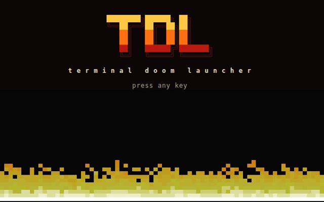

# tdl

A terminal launcher for [UZDoom](https://github.com/UZDoom/UZDoom). Group your wads into named profiles, launch them in one keypress, and host or join multiplayer games, with missing wads downloaded automatically from the host.



## Features

- **Profiles**: an ordered list of wads with an optional per-profile UZDoom binary, base wad and `.ini`
- **One-key launch**: pick a profile and press `Enter`
- **Host**: choose player count, deathmatch or co-op, and a starting map
- **Join**: enter the host's IP; tdl picks a compatible profile, or offers to download the wads and create one
- **Import** a whole folder of wads into a profile
- **Per-profile saves** and a `session.log` of UZDoom's output

## Requirements

- A recent **nightly** Rust toolchain (the project uses unstable features)
- [UZDoom](https://github.com/UZDoom/UZDoom) installed
- A Doom base wad (e.g. `DOOM2.WAD`, or the free [Freedoom](https://freedoom.github.io/))

## Install

```sh
git clone https://codeberg.org/Error-ErrorFruitUser/tdl.git
cd tdl
cargo +nightly build --release
./target/release/tdl
```

## Usage

On first run, press `U` to select your UZDoom executable and `W` to select a base wad, then `A` to create a profile.

| Key | Action |
| --- | --- |
| `Enter` | Launch the selected profile (on `+`, create a profile) |
| `H` | Host a game |
| `N` | Join a game |
| `J`/`K`, `↓`/`↑` | Move selection |
| `}` / `{` | Move the profile down / up |
| `A` | Add a profile |
| `E` | Edit a profile |
| `D` | Delete a profile |
| `U` | Select the UZDoom executable |
| `W` | Select the base wad |
| `Esc` | Save and quit |
| `?` | Show the keys for the current screen |

Inside the profile editor, `Tab` switches between the name and the wad list, where `A` adds a wad, `F` imports a folder, `D` removes one, `}`/`{` reorder, and `U`/`W`/`I` set the profile's own UZDoom, base wad and ini.

### Multiplayer

The host serves its wad list on port **8080** while the game runs, so that port must be reachable by joiners. Joiners enter the host's IP; if no local profile matches, tdl offers to download the wads into a new profile.

### Data locations

Config and profiles live in your platform's config directory, saves, logs and downloads in its data directory:

| OS | Config | Data |
| --- | --- | --- |
| Linux | `~/.config/tdl` | `~/.local/share/tdl` |
| macOS | `~/Library/Application Support/error.error.fruit.eef.tdl` | same as config |
| Windows | `%APPDATA%\eef\tdl\config` | `%APPDATA%\eef\tdl\data` |

To use a different location, pass a vault folder:

```sh
tdl --vault /path/to/dir   # uses /path/to/dir/config and /path/to/dir/data
```

## Recording the demo

```sh
cargo build --release
vhs demo.tape
```

The tape runs against a temporary copy of your config, so your real profiles are not modified.

## License

[0BSD](LICENSE)
